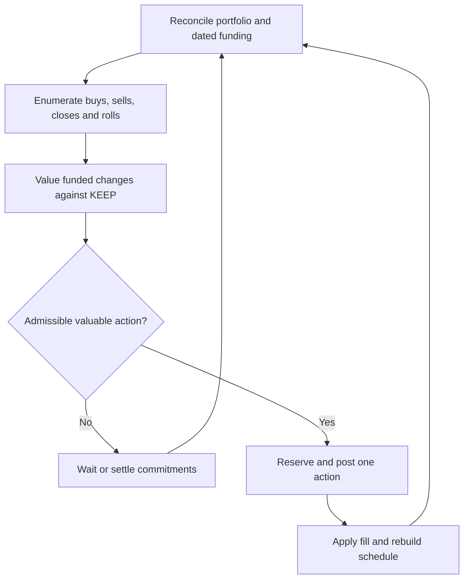

# Funded single-leg trading: separate study

19 October 2026 | Analytical comparison and test design. No new portfolio backtest.

## Question and conclusion

Can we choose successive individual longs and shorts, then close or roll them,
using the portfolio's funding schedule rather than requiring execution pairs?
**Yes as an algorithm design.** Pair identity is unnecessary for cash/inventory
conservation. It remains useful for committed spread execution and attribution.
The alternatives have identical cash flows when they execute identical trades;
any performance difference comes from the trades, timing, quantities and costs
their selection rules produce. Greater flexibility alone does not prove profit.

## Findings that apply to both algorithms

**1. Use total net return to admit an opportunity.** A three-month floor is a
coarse proxy for sufficient carry. A minimum unannualized net return, after
fees and funding, tests the intended economics more directly. Near expiry may
offer little absolute carry, but exceptional spreads can still pass. Keep
operational deadlines and price/quantity liquidity checks. A large annualized
slope over a tiny interval can still fail the total-return floor.

With no discounting/costs, price gaps of $30 over 0.002 year and $600 over
0.25 year give slopes $15,000 and $2,400 per BTC/year. At $100,000 spot the
unannualized returns are 0.03% and 0.60%. An illustrative 0.10% floor rejects
the higher-slope opportunity. These are arithmetic examples, not observations.

**2. The raw chronological slope cannot select direction.** Interpret the
user's numerator as F2-F1. Swapping both prices and both maturities leaves
(F2-F1)/(T2-T1) unchanged. Keep an explicit long/short orientation and h equal
to the absolute expiry separation. The simple annualized forward price return
(F_later/F_earlier-1)/h is dimensionless, but still excludes costs, interim
margin funding and the alternative Treasury return.

**3. Treasury funding changes the comparison.** A planning screen for an
equal-q oriented package is q*(P_short*F_short-P_long*F_long)-costs, with P
the contemporaneous Treasury discount factor. It compares effective dated
purchase/sale obligations in common present-value units. It is not an exact
discounted cash-flow identity for daily-settled futures; actual variation,
financing and Treasury transactions must be replayed. A curve-implied forward
reinvestment rate is not a locked future investment unless it can be executed.

**4. Side-specific quote signs must be consistent.** The user's raw-price
limits are L_long=F_short-Delta*d_long and L_short=F_long+Delta*d_short.
For Delta>0, smaller d_long buys more aggressively and smaller d_short sells
more aggressively. For Delta<0 both effects reverse. The main algorithm uses
abs(Delta), explicit direction and Treasury discount factors to preserve the
intended urgency for either expiry order. d has USD/BTC/year units; optional
spot normalization must be declared rather than mixing it with old APR gaps.

<!-- pagebreak -->

## Single-leg execution flow

**1. Reconcile actual positions.** Keep cash, matched-maturity Treasuries,
BTC/proxy, signed futures, execution lots and pending orders. Maintain dated
funding dependencies without permanent execution-pair IDs.

**2. Enumerate marginal actions.** Buy/sell a future, reduce a position,
transfer spot/proxy to a future, or replace an expiry. Net opposing trades in
the same contract. Include required Treasury, margin and backing adjustments.

**3. Compare with KEEP.** A fresh long alone has no locked profitable terminal
cash cycle: its resale value is unknown. Compare its funded acquisition cost
with direct BTC/another long, or with existing covered sale obligations.
For cash allocated to BTC, a simplified comparison is P_i*F_i plus costs per
BTC versus spot. This changes exposure; it is not immediately realized profit.
A short requires underlying backing and a defined continuation policy. Gain
requiring a future unfilled order is conditional. Baseline restoration is separate.

**4. Admit globally.** Check dated backing, exposure, gross leverage, margin,
collateral availability and pending fills. Reassign unallocated resources across
the portfolio. A planned order is not received backing; bridge any roll gap.

**5. Select and execute.** Rank feasible changes against KEEP after costs.
Favor longs near the floor and shorts near the ceiling. The simplest prototype
posts one newly selected action at a time, while reconciling existing orders.
After every partial fill, choose again. Use the same latency and tape rules.

**6. Close, roll or settle.** Use actual cash-flow history and Treasury values;
perform funded spot trades at expiry. Derive closed-cycle attribution from
execution/dependency links afterward, without making it an admission constraint.

<!-- pagebreak -->

## What changes and what stays

| Feature | Paired algorithm | Single-leg alternative |
| --- | --- | --- |
| Commitment | Intended counterpart and matched target | Re-select each marginal action |
| Waiting | Pair and conditional catch-up clocks | Action review and residual-inventory age |
| Inventory reuse | Explicit reassignment between pairs | Global dated backing ledger |
| Ladder occupancy | Completed matched quantity only | Needs a separate definition |
| Funding/accounting | Actual dated obligations | Same constraints and obligations |

For a fair first comparison, **disable incremental ladders in both arms** while
retaining the same exposure-dependent quote bias. This isolates pair commitment.
Then add completed-pair ladders, and compare a separately labeled single-leg
inventory penalty based on side exposure and resource use. Retrospective matching
can instead award credit once both sides exist, but restores some pair logic.
A lone long must not be equated with a filled paired rung.

Potential benefits are broader inventory reuse, cheaper substitutions and less
waiting for a specific counterpart. Potential costs are more directional
inventory, turnover and selection complexity. Attractive individual trades can
combine into a poor portfolio; more flexibility does not establish higher return.

## Controlled empirical study

1. Use identical initial portfolios, linear payoff, Treasury curve, collateral,
   band, leverage, costs, quote proximity, latency and shared volume rules.
2. Include near-expiry windows discarded by the old three-month screen. Label
   any linear simulation on inverse-contract tape as a proxy, not native evidence.
3. First vary only paired versus single-leg scheduling, with a common return
   gate and no incremental ladders. Then vary the maturity gate, price signal,
   and finally the separately defined ladders. Avoid conflating their effects.
4. Calibrate on prior windows; score subsequent continuous paths through rolls
   and expiry. Both arms start identically; later state divergence is an outcome.
5. Compare net excess return over the same funded baseline, drawdown, exposure
   occupancy, residual inventory age, utilization, costs and funding stress.
   Keep unfinished inventory and adverse recovery, not only profitable closures.

**Decision criterion:** better net outcomes or comparable return with more
usable capacity and acceptable risk. Turnover or near-full leverage alone is
not success. Exposure should move naturally within its permitted band; do not
force trading merely to touch both boundaries.

**Recommendation:** share one funding/risk engine between policies. Keep pair
ownership separate from backing, so the single-leg alternative reuses the same
accounting and settlement. The empirical comparison must decide performance.
Outstanding: KEEP valuation/continuation horizon, minimum return, single-leg
quote targets, resource priority, review actions and optional inventory penalty.
No single-leg calibration or historical profitability result is claimed here.

Mechanics references: [TreasuryDirect - Treasury bills](https://treasurydirect.gov/marketable-securities/treasury-bills/);
[CME - futures cash variation](https://www.cmegroup.com/education/articles-and-reports/money-calculations-for-futures-and-options).
