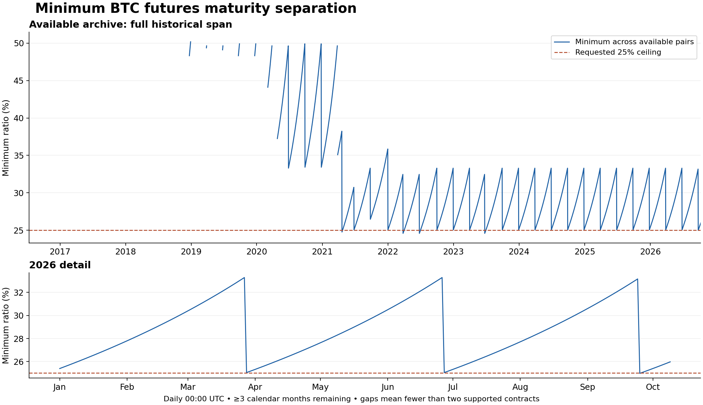

# BTC minimum maturity separation: saved historical archive

2026-10-13. **The requested 25% ceiling admits futures/futures openings only
rarely in this archive.** Across all saved instruments, five qualifying
coverage windows total 617.933 hours (25.747 days). In 2026 through October 9,
only September 24–25 qualifies. Proxy pairs remain exempt under the design.
This report measures maturity geometry and archive coverage, not liquidity,
strict-through fills, portfolio returns or an implemented strategy.



## What was read and verified

The completed archive is `btc-full-20261009-archive`. Its
[completion run](https://github.com/leviitzhak/keep_and_lease/actions/runs/38123539841)
published `COMPLETE_AVAILABLE_HISTORY` on October 11. A bounded
[read-only export](https://github.com/leviitzhak/keep_and_lease/actions/runs/38386572412)
retrieved its frozen plan, manifest and eight completed-shard records. Their
12,322 receipt keys cover the planned chunks exactly once. Source object
generations and SHA-256 hashes were retained and checked locally.

There are 540 catalog instruments: 509 have available raw records, totaling
120,105,433 sequence records; 31 have none. Eleven instruments have explicitly
unavailable prefixes. Catalog metadata begins July 13, 2016; the earliest saved
trade is January 6, 2017. The snapshot was frozen October 9, 2026, with
instrument-specific cutoffs. This calculation ends at **October 9, 00:00 UTC**,
before all those partial-day cutoffs, not at the current date.

The full 120 million raw rows were not downloaded or rescanned for this
metadata-only question. Completion records certify acquisition under the
archive's policy, not exchange-wide completeness. The previous direct raw
preflight scanned 1,149,605 records in two selected datasets; its strict-through
quote screen remains separate. This analysis uses expiry, creation and
first/last observed trade boundaries, which suffice for maturity availability.
It does not establish a fresh executable quote at every sampled instant.

## Definition and reproducibility

At time t, consider distinct dated inverse BTC futures with:

- metadata creation time no later than t;
- expiry at least `add_calendar_months(t, 3)`, UTC with end-of-month clamping;
- for the archive-supported series, first observed raw trade no later than t
  and last observed raw trade no earlier than t.

Then compute, **before applying any 25% filter**:

```
minimum_ratio(t) = min_pairs abs(expiry_i-expiry_j) / (max(expiry_i,expiry_j)-t)
```

With fewer than two eligible instruments, the result is missing, not zero.
Sort expiries and compare adjacent ones: for a fixed farther expiry, the closest
nearer expiry minimizes the ratio. The script checks this optimization against
all pairs at every daily sample. It also computes exact qualifying intervals
at millisecond precision from listing/coverage, calendar maturity and the
algebraic boundary `t <= far_expiry - 4 * expiry_gap`, including intraday periods
that daily sampling could miss. Equal-boundary timestamps are eligible.

Daily series span 3,741 midnights from July 13, 2016 to October 9, 2026.
There are 2,409 samples with a pair, of which 26 pass 25% (1.079% of pair-present
samples). The metadata-listed and archive-supported daily minima agree in this
snapshot; those are separate calculations, not an assumption. There is no pair
at the other 1,332 midnights. The first pair-present midnight is December 22,
2018. This is not a claim that earlier BTC futures did not trade: fewer than
two met this three-month requirement in the saved catalog.

Artifacts:

- [Monthly table for the entire history](research/BTC_MATURITY_MONTHLY.md):
  smallest/largest daily minima and eligible-day counts for every month.
- [Every daily value and minimizing pair](research/btc-maturity-daily.json).
- [Summary and exact qualifying windows](research/btc-maturity-summary.json).
- [Normalized source catalog and acquisition evidence](research/btc-maturity-catalog.json).
- [Reproducible calculation](research/btc_maturity_separation.py).

Run `python docs/research/btc_maturity_separation.py` from the repository root.
The script requires Python and matplotlib; it makes no network requests.

## Minimum across pairs, by year

The range below is the range of the **daily minimum** within each year. It is
not the range across all possible pairs. The 2026 row ends October 9.

| Year | Smallest daily minimum | Largest daily minimum | Midnights with a pair | Midnights ≤25% |
| --- | ---: | ---: | ---: | ---: |
| 2016 (from Jul 13) | — | — | 0/172 | 0 |
| 2017 | — | — | 0/365 | 0 |
| 2018 | 48.319% | 50.184% | 8/365 | 0 |
| 2019 | 48.319% | 49.909% | 19/365 | 0 |
| 2020 | 33.293% | 49.909% | 275/366 | 0 |
| 2021 | 24.754% | 49.636% | 364/365 | 4 |
| 2022 | 24.572% | 33.293% | 365/365 | 14 |
| 2023 | 24.572% | 33.293% | 365/365 | 7 |
| 2024 | 25.046% | 33.293% | 366/366 | 0 |
| 2025 | 25.046% | 33.293% | 365/365 | 0 |
| 2026 (through Oct 9) | 24.977% | 33.293% | 282/282 | 1 |

## Exact windows that pass 25%

End times below are inclusive; start times are rounded to the second for display.
The JSON retains exact milliseconds. Durations use millisecond precision.
An instrument's first raw print establishes coverage, not that a decision based
on it could already have reached the exchange at that instant.

| Start UTC | Last eligible time UTC | Pair | Hours |
| --- | --- | --- | ---: |
| 2021-04-19 12:03:38 | 2021-04-23 08:00:00 | Dec21 / Mar22 | 91.940 |
| 2022-03-25 08:55:00 | 2022-04-01 08:00:00 | Dec22 / Mar23 | 167.083 |
| 2022-06-24 08:34:47 | 2022-07-01 08:00:00 | Mar23 / Jun23 | 167.420 |
| 2023-06-23 08:24:30 | 2023-06-30 08:00:00 | Mar24 / Jun24 | 167.592 |
| 2026-09-24 08:06:06 | 2026-09-25 08:00:00 | Jun27 / Sep27 | 23.898 |

## 2026 snapshots

These are values at the specified midnight, not monthly averages.

| UTC date | Minimum ratio | Minimizing pair |
| --- | ---: | --- |
| Jan 1 | 25.395% | Sep26 / Dec26 |
| Feb 1 | 27.800% | Sep26 / Dec26 |
| Mar 1 | 30.401% | Sep26 / Dec26 |
| Apr 1 | 25.325% | Dec26 / Mar27 |
| May 1 | 27.632% | Dec26 / Mar27 |
| Jun 1 | 30.503% | Dec26 / Mar27 |
| Jul 1 | 25.325% | Mar27 / Jun27 |
| Aug 1 | 27.716% | Mar27 / Jun27 |
| Sep 1 | 30.605% | Mar27 / Jun27 |
| Sep 25 | 24.977% | Jun27 / Sep27 |
| Oct 1 | 25.395% | Jun27 / Sep27 |
| Oct 9 | 25.975% | Jun27 / Sep27 |

## Implications for the proposed experiment

A 91-day gap requires at least 364 days to the farther expiry to pass 25%.
The same pair's ratio rises as time passes. The sawtooth pattern reflects new
longer-expiry listings becoming available; APR direction does not affect it.
Rolling both legs can expand the candidate set relative to keeping one fixed,
but cannot create an eligible dated pair when the global minimum exceeds 25%.

Keep 25% as the requested baseline. If a futures/futures experiment is desired
outside these sparse windows, compare explicitly labeled sensitivity scenarios
such as 30%, one-third and 35%, alongside the proxy-enabled scenario. Do not
silently relax the rule or select a threshold to maximize in-sample P&L.
The archived minimum also constrains roll feasibility; a held pair can remain
open after losing entry eligibility, and a ratio-only roll trigger remains an
unresolved policy choice.

Calibrate H and L on suitable eligible tape after accounting for this scarcity.
Use the same starting cash, latency, funding, ladder, strict-through participation
and exit escalation in comparisons. Calibrate `H=L+w` for both location L and
width w: APR convergence alone is not actual cash P&L for unequal maturities.
See the [strategy plan](BTC_PRD_EXPOSURE_BAND_PLAN.md) for the exact identity
and proposed research gates. No capital-constrained portfolio backtest is
claimed by this report.

Operator metadata-export branch: `agent/cloud-autonomous-access`, commit
`b5e5c9da0e91095a74ff8a4ed4b22a959059c530`. The exporter used existing access,
read only ten saved metadata objects and did not resume a download or deploy.
