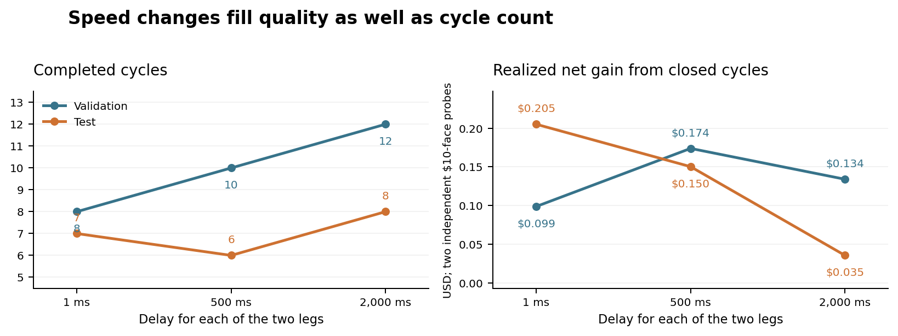

# BTC PRD: expense accounting, fees, latency and longer history

Research update, 14 October 2026. These are independent one-contract execution
probes, not the funded exposure-band strategy or an investment return estimate.
The original [calibration report](BTC_PRD_EXECUTION_CALIBRATION.md) remains the
record of the earlier experiment. No application strategy or deployment changes.

Subsequent owner requirement: infer both location and gap from recent data and
update them live. The runs below fit each grid once and hold it fixed; they are
controls, not evidence for an adaptive policy. See the proposed
[live calibration and competing-market research design](BTC_PRD_ADAPTIVE_MARKET_RESEARCH.md).

## Expense APR and economic decay

The proxy APR `e/(1-e) + c` affects the future limit price required to meet a PRD.
It is a quote/ranking input, not a cash payment. The gross-index synthetic proxy
then loses BTC-equivalent exposure once according to:

```
q(t) = q(0) * (1-e)^years * exp(-c*years)
```

There is no additional APR debit to cash. For example, with e=2%, c=0 and flat
spot, a $10 proxy holding is worth $9.80 after one year: a $0.20 loss, not that
loss plus another 2.0408% charge. A focused acceptance case checks this identity.
If actual proxy prices already include expenses, explicit expense decay must be
turned off. The modeled units are BTC-equivalent exposure, not literal ETF shares.

The `exp(-c*years)` part is explicitly a simplified liquidity-cost sensitivity.
It does not simulate margin-driven selling and rebuying. The eventual funded
ledger should replace it with actual simulated liquidity cash flows, without
also charging this same forecast cost. Expense and surcharge effects are now
reported separately. Because the cost scenario also changes quote levels, its
P&L difference from base is not a pure cost deduction on unchanged fills.
`e/(1-e)` is the agreed annual ranking convention; the
horizon-exact inverse retention cost is `((1-e)^(-years)-1)/years`, so the annual
ranking convention is not an exact simple-rate conversion at every tenor.

## Realized and unrealized reporting

Every result now reconciles:

```
total marked P&L
  = completed-cycle realized net P&L
  + realized net P&L within the unfinished cycle
  + unrealized marks of remaining holdings
```

The middle term matters when the short has already been closed but the proxy
sale is still pending; it also contains fees already paid and rebates received.
It must not be described as entirely unrealized. Each cycle retains separate
native-inverse-future realized P&L, proxy price change, expense effect,
liquidity-cost effect and transaction fees. Remaining proxy and future marks
are separate. Native BTC futures P&L is normalized into USD at its execution or
mark index; this is not a funded BTC collateral-wallet simulation.

## Controlled comparison on the original 2026 data

The 13 previously frozen H/L settings are retained. December 2026 and March
2027 futures are tested independently in June 6-July 21 validation and July
21-September 4 test slices. All 180 source files are hash verified: 486,203 raw
rows, 462,642 ordinary records. There are 416 scenario results, including 260
actual execution replays and 156 fee-only revaluations. All 20,475 saved fills
pass an independent raw-tape, price, aggressor, volume, latency and cash audit.
All 208 overlapping cases reproduce the original cycle counts and marked P&L.

Fee-only revaluation is exact for this unfunded probe because fees cannot alter
its quotes, inventory size or admission. That shortcut must not be applied to
a funded strategy if fees change available cash or margin headroom.

| Scenario | Future fee per fill | Proxy fee per fill | Delay per leg | Posting distance |
|---|---:|---:|---:|---|
| Base | +1 bp | +1 bp | 500 ms | 1% |
| No fees | 0 | 0 | 500 ms | 1% |
| Maker rebate sensitivity | -1 bp | 0 | 500 ms | 1% |
| Smaller maker rebate | -0.2 bp | 0 | 500 ms | 1% |
| Low delay | +1 bp | +1 bp | 1 ms | 1% |
| Longer delay | +1 bp | +1 bp | 2,000 ms | 1% |
| Always posted | +1 bp | +1 bp | 500 ms | Unrestricted |
| Proxy cost | +1 bp | +1 bp | 500 ms | 1%; e=0.25%, c=0.50% annually |

Zero/negative transaction fees do not imply zero proxy holding costs when an
expense or surcharge is configured separately. These particular fee comparisons
retain zero expense/surcharge to match the original base.

Deribit's official fee material describes maker rebates for qualifying tiers;
a limit order alone does not guarantee maker execution, and futures-combo fees
are different. The schedule changed effective August 1, 2026. Therefore the
negative-fee rows above are declared conditional scenarios, not a reconstruction
of the account's historical fees. Proxy trades receive no futures-maker rebate.
Sources: [Deribit fees](https://support.deribit.com/hc/en-us/articles/25944746248989-Fees)
and [fee-schedule change](https://insights.deribit.com/exchange-updates/new-fee-schedule-on-deribit/),
checked October 14, 2026. Without book data the replay cannot certify post-only
acceptance or maker status; marketable limits are still modeled by subsequent
strict-through prints, rather than an invented immediate fill.

The following example retains the previously illustrated 3.75%/2.75% thresholds;
it was not selected as a winner. Dollars are sums of two independent $10-face
probes, with no common capital denominator. They are not percentage returns.

| Later test scenario | Completed cycles | Realized: closed cycles | Realized: unfinished cycle | Unrealized marks | Total marked |
|---|---:|---:|---:|---:|---:|
| Base, 500 ms | 6 | $0.150211 | -$0.003964 | $0.035310 | $0.181557 |
| 1 ms | 7 | $0.205063 | -$0.003963 | $0.035312 | $0.236411 |
| 2,000 ms | 8 | $0.035453 | -$0.003965 | -$0.039556 | -$0.008069 |
| No fees | 6 | $0.174238 | $0.000000 | $0.035310 | $0.209548 |
| -1 bp future / 0 proxy | 6 | $0.186096 | $0.001964 | $0.035310 | $0.223370 |
| -0.2 bp future / 0 proxy | 6 | $0.176609 | $0.000393 | $0.035310 | $0.212313 |
| Always posted | 8 | $0.325759 | -$0.003967 | -$0.036084 | $0.285707 |

In validation, the same 1 ms setting completes 8 cycles versus 10 at 500 ms;
marked P&L is -$0.004935 versus +$0.077433. Across all 52 matched grid/sample
cases, 1 ms yields more cycles in 15, fewer in 11, and the same number in 26.
Closed-cycle net P&L improves in 22 of those 52 comparisons, worsens in 5 and
is unchanged in 25. These overlapping grid cases are descriptive, not independent
statistical evidence. Faster access alone expands a fixed quote's potential opportunity set, but this
strategy repeatedly changes prices and follows different inventory paths after
fills. Cycle count and net profit therefore need not improve monotonically.
The 2-second example even completes more cycles while losing money.



`always_posted` means that the distance-from-recent-trade admission/cancellation
filter is disabled. PRD prices, one active lifecycle phase, inventory, three-month
entry eligibility, strict-through fills, participation and both latency legs
remain in force. It does not mean every pair or both sides are simultaneously
posted, nor does it reserve unlimited capital. Posting distance uses last trades,
not an unavailable bid/ask book. At 1 ms there is still a 1 ms data/notification
leg plus a 1 ms order-command leg; arrival ties do not fill retrospectively.

## Longer-history method

The completed October 9 frozen archive contains 540 contracts, 509 with trades,
and 120,105,433 raw records. Forty-two contracts have some trading history while
at least three calendar months remain to expiry; weekly and other ineligible
contracts are not fabricated into trading candidates. Their entire saved tapes
contain 92,038,192 rows, including periods too close to expiry for this study.

For each eligible contract, quote locations come only from the first third of
its entry-eligible calendar history. The time-weighted 25th/50th/75th percentiles
are rounded to 0.25 percentage points. The frozen locations are crossed with
0.25/0.50/1.00-point gaps, plus the fixed 2%/1% reference. The remaining history
is held out and replayed continuously from cash for that independent probe.
Recent short histories can have short training windows; their training coverage
and maximum carried-observation age are saved, not concealed.

Replay stops at the archive boundary or just before 60 days remaining. Entries
stop at three calendar months; existing closes may fill afterward. Residuals
are marked, not assumed liquidated. This tests the quote/cycle mechanism over
the eligible history, but does not yet enforce the strategy's required deadline
through rolls or escalation. No funded return or optimal H/L is selected.

All relevant compressed raw objects are hash verified. Sequence order is
preserved: backdated prints are excluded rather than moved backward in time.
Flagged/block/combo prints and invalid execution prices/index/amounts are counted
and excluded. Early records lacking a valid exchange mark retain their valid
trade/index observations; valuation uses an explicitly counted last-trade-price
fallback. Such a valuation is not an exchange margin mark. Historical ticks use
the metadata snapshot for each contract; historical tick-change schedules are
not reconstructed. Source receipts and every execution fill remain auditable.

This extension covers proxy/future pairs. It does not claim an executable
futures/futures portfolio or apply a maturity-separation filter to a proxy.
Multi-pair capital allocation, reversible live ladders, paired rolls, native
margin/collateral and arbitrary-position restarts remain the next implementation
stage. Completed-cycle P&L alone cannot establish that those rules are feasible.

## Full eligible-history results

All eight shards completed successfully. The study read and hash-verified
57,021,626 raw records, retaining **55,954,166 ordinary observations** from
**March 27, 2017 through October 9, 2026**. The earliest held-out replay starts
March 28, 2017. There are **407 contract/threshold cases**, **2,035 execution
replays** and **1,221 fee-only revaluations**, giving **3,256 scenario results**.
All **1,173,177 saved fills** pass their independent raw-tape/accounting audit;
every result's realized/unrealized reconciliation also passes.

The 92,038,192 rows in eligible contracts' complete saved tapes are not all
execution-eligible: 35,016,566 are in wholly post-cutoff chunks and are not read.
Of the loaded rows, 184,111 are outside the study end, 883,260 have excluded
trade flags, 23 are backdated, 46 have invalid contract amount/direction and 20
have invalid execution numerics. Missing/invalid marks are replaced by the
explicit trade-price valuation fallback for 358,883 otherwise valid rows;
three contracts have this fallback at the terminal valuation. No invalid index
or execution price is silently replaced.

This table groups contracts by the year their held-out replay begins. Its PRD
column is the median of their individual training medians, not a calendar-year
market average. Contract test windows can extend into the following year.

| Held-out start year | Contracts | Median training PRD | 2%/1% completed cycles | Contracts with a completed cycle |
|---|---:|---:|---:|---:|
| 2017 | 4 | 9.69% | 271 | 4 |
| 2018 | 4 | 0.76% | 234 | 3 |
| 2019 | 4 | 1.89% | 175 | 4 |
| 2020 | 5 | 5.80% | 323 | 4 |
| 2021 | 5 | 9.97% | 672 | 5 |
| 2022 | 4 | 2.47% | 975 | 4 |
| 2023 | 4 | 4.00% | 31 | 3 |
| 2024 | 4 | 11.30% | 0 | 0 |
| 2025 | 4 | 7.18% | 19 | 4 |
| 2026 | 4 | 4.25% | 3 | 1 |

The fixed 2%/1% reference is deliberately unchanged across these periods. It
completes at least one cycle for 32 of 42 contracts; the 2024-starting group
completes none. At the end of the base probes, 16 contracts still have an open
short and 10 hold proxy without a short. These facts prevent treating cycle
completion or entry availability as a universal property of the thresholds.

The following dollar sums are across 42 independent $10-face probes and
potentially overlapping periods. They are accounting diagnostics, **not portfolio
returns or performance on $420 of allocated capital**. No grid winner is chosen.

| Fixed 2%/1% scenario | Closed cycles | Realized: closed cycles | Realized: unfinished | Unrealized marks | Total marked |
|---|---:|---:|---:|---:|---:|
| 500 ms base | 2,703 | -$51.4574 | -$0.0418 | $10.7908 | -$40.7084 |
| 1 ms | 2,401 | -$46.8225 | -$0.0458 | $9.5085 | -$37.3598 |
| 2,000 ms | 3,165 | -$71.1569 | -$0.0338 | $10.0746 | -$61.1161 |
| No fees | 2,703 | -$40.6711 | $0.0000 | $10.7908 | -$29.8803 |
| -1 bp futures / 0 proxy | 2,703 | -$35.2942 | $0.0158 | $10.7908 | -$24.4876 |

Removing fees alone does not rescue this fixed-reference lifecycle. Its base
closed-cycle net -$51.4574 decomposes exactly into:

| Interval / cost | USD sum |
|---|---:|
| Proxy movement before the short opens | -35.0309 |
| Combined gross P&L while both legs are open | +10.0617 |
| Proxy movement after the short closes, before proxy sale | -15.7019 |
| Transaction fees | -10.7863 |
| Completed-cycle realized net | -51.4574 |

For example, a November 2018 cycle buys the synthetic proxy around index 6,166.65
and waits about 5.76 days before the short opens around index 4,234.21. That
cycle loses about $3.11 per $10 initial proxy even though the actual short entry
and exit PRDs are approximately 2.01% and 0.96%. Thus the executed PRD gap alone
cannot describe the P&L of the entire four-stage cycle. A future funded portfolio
must attribute deliberate baseline BTC exposure separately and size the lagging
short against actual inventory/exposure headroom.

Stale references also matter. The June 2018 contract's base mean executed entry
PRD is about 0.43% versus its 2% target, and mean exit PRD about 1.41% versus its
1% target. Orders use observed indices and remain exposed until amendments
arrive; they are not retroactively rejected when the realized spread is worse.
Sparse trade-attached index data, large historical index changes and synthetic
proxy observations limit how confidently these execution probes represent an
actual continuously observed market. The raw-data audit proves the declared
simulation was followed, not that every historical index or maker assumption
matches a tradable book. The paired-phase decomposition is still a unit probe,
not a separately delta-neutral portfolio.

Across the complete 407-case grid, 1 ms produces more cycles in 94 cases, fewer
in 219 and the same number in 94. Closed-cycle net gains improve in 267, worsen
in 85 and are unchanged in 55. Total marked P&L improves in 255, worsens in 102
and ties in 50. Two-second delays produce more cycles in 274 cases, but worsen
closed-cycle net P&L in 308. More executions are not necessarily better executions.
These overlapping comparisons are descriptive and do not establish statistical
significance or a funded strategy return.

Twenty training-derived cases have a negative opening PRD; these are explicit
backwardation sensitivities, not approved production settings. Neither the
calibration grid nor this report silently overrides the strategy's long/short
selection, exposure bounds or proxy ownership rules. Broadening the history has
identified two priorities before optimization: separate baseline/unpaired BTC
P&L from paired-cycle P&L, and validate the execution/index assumptions and actual
margin-funded lifecycle. A universal H/L winner is not supported by these probes.

## Audit and reproducibility

The run is [38597440889](https://github.com/leviitzhak/keep_and_lease/actions/runs/38597440889),
operator commit `e0042cafebcbb6541916833697193786c3fe72ce`. All eight jobs succeeded;
no application deployment was triggered. The preliminary attempt rejected early
records without marks; the final run explicitly handles those missing marks
and replaces the preliminary results completely.

The maintained research scripts and compressed aggregate outputs are under
`docs/research/extended-results/`. Source receipts/hashes, per-contract summaries,
all 3,256 results, the cycle-interval attribution, and the original 2026 extension
are retained. Full per-fill historical logs are in the workflow's eight artifacts
(about 62.1 MiB compressed together), with scheduled expiry November 13, 2026;
they can be regenerated from the immutable source cache and recorded code.
The repository retains the smaller aggregate results independently of those
artifact lifetimes. The offline guide contains exact cache and replay commands.
