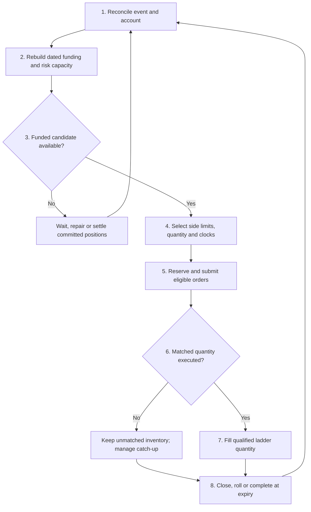

# Funded futures strategy: execution algorithm

19 October 2026 | Regular linear futures + matched Treasuries + BTC/proxy.
Proposed research revision; numerical parameters and performance remain unvalidated.
This replaces the previous 13-page description. The separate single-leg study
examines trading without execution pairs.

## Algorithm flow



## Signals: total return first, rate second

Interpret the requested `(F2-F2)/(T2-T1)` as `(F2-F1)/(T2-T1)`.
With long L and short S, define Delta=T_S-T_L and h=abs(Delta), in years.
The raw slope `(F_S-F_L)/Delta` has USD/BTC/year units, not APR, and is
unchanged when both legs are swapped. Evaluate both directions explicitly.

**Proposed Treasury-aware signal.** Let P_i be today's price of $1 available
at T_i, and q the matched BTC quantity. At a common observation time:

```
B = P_S*F_S - P_L*F_L
G_est = q*B - estimated_incremental_costs
R_abs = G_est / (q*spot)          # unannualized, not return on NAV
 d = B / h                      # USD/BTC/year
```

Use R_abs >= R_min for ordinary pair admission; d controls quote selectivity.
This is delivery-equivalent present-value screening relative to Treasury
funding, not exact futures P&L: model actual Treasury trades and path-dependent
variation-margin financing separately. Future reinvestment is not locked unless
an executable hedge secures it. Exclude h=0 from this slope policy.

<!-- pagebreak -->

## Steps 1-3: state, funding and admission

**1. Reconcile.** Apply actual fills, Treasury cash flows, fees and settlement
once; deliver observations after their delay. Restore lots, pending orders,
reservations and clocks on restart. Keep an immutable execution journal.

**2. Rebuild the schedule.** Maintain available cash C(u) and underlying U(u)
for all future event times u, after reservations. Allocate Treasury maturities
available by each long's purchase date, plus a separate margin cash reserve.
Earlier covered short proceeds can fund later longs; earlier funded longs can
cover later shorts. Allocate each receipt once. Include coupon/redemption dates,
proxy decay, settlement/transfer delays and actual collateral availability.
Check every event boundary and any intervening modeled decay/accrual extremum.

Long expiry has economic effects (-q*K_L cash, +q BTC); short expiry has
(+q*K_S cash, -q BTC). These are planning totals. Actual variation cash and
spot transactions are booked separately and reconciled, never added twice.
Treasury principal already held is an asset, not new interest income.

**Transform, then check.** For an opening, close or roll, net trades against
actual positions and rebuild the resulting schedule. A replacement is allowed
when the reconstructed schedule and executable sequence are funded. Reserve
bridge resources for a temporary gap, or use supported atomic execution.
A long merely planned for a few seconds later is not a confirmed receipt;
independent orders can fail or fill in the opposite order. Recheck after each fill.

**3. Build candidates and size.** In the proposed variant, replace the three-month
entry floor with the net unannualized return gate. Near-expiry candidates remain
possible if return, liquidity, execution time and settlement access suffice.
Do not recreate the old maturity floor through a blanket retirement ban.
Maturity-separation limits remain configurable comparisons, not profitability tests.

Use current marked NAV E, net exposure x and gross futures leverage:

```
x = spot*(BTC + proxy_BTC + sum(signed_futures_BTC)) / E
leverage = sum(abs(net_quantity_i)*F_i) / E
```

Paid BTC/proxy is excluded from futures leverage. Size from exposure headroom,
funding, leverage, margin and shared pending-order capacity, with native rounding.
Below the exposure floor, suppress shorts and acquire the best funded long;
this baseline acquisition is separate from a profitable paired-entry gate.
At the ceiling block new exposure-increasing longs. Price-only excess does not
force selling. Unsupported initial positions remain visible during recovery.

## Step 4: choose side-specific limits

Use separate d_long(x,k) and d_short(x,k), where k denotes each side's ladder:

```
limit_long  = (P_S*observed_short - h*d_long) / P_L
limit_short = (P_L*observed_long  + h*d_short) / P_S
```

Lower d_long raises the buy limit; lower d_short lowers the sell limit. These
urgency effects hold for either expiry order. With P=1 and long-before-short,
these reduce to the user's formulas. For the opposite order, the signed-Delta
form reverses the urgency effect; use h and the explicit trade direction above.
Near the floor favor lower d_long and higher d_short; near the ceiling reverse
that bias. Calibrate the amounts. For a proxy, use its immediate cash-flow date
and P=1, while budgeting its holding costs and future backing quantity.

<!-- pagebreak -->

## Steps 5-7: execution, waiting and ladders

**5. Reserve and submit.** Reserve all admissible partial-fill outcomes before
posting. Round buys down and sells up; post only within the broad configured
market-distance threshold. Orders become effective after order delay. An event
can influence a new order only after observation plus order delay.

In trade replay, fill at the limit only after a later compatible-aggressor trade
strictly through it, using a shared finite volume budget. Equality does not fill.
Cancellation releases capacity only after acknowledgement/reconciliation.

**6. Use distinct clocks.** A time budget is a review rule, not a fill guarantee.

| Clock | Start and purpose |
| --- | --- |
| W_pair | Initial decision to both legs filling the requested quantity; includes no-fill and first-fill waiting |
| W_short_given_long | Actual long fill to matching short fill; decisions use that fill only after its notification delay |
| W_long_given_short | Separate reverse catch-up clock if short-first execution is permitted by the band |

For new longs, a proposed policy is W_new=W_fast+(W_slow-W_fast)*u^gamma,
where u=clip((x-x_min)/(x_max-x_min),0,1). At/above x_max no new long is posted.
Calibrate W_pair and conditional clocks separately; do not give an urgent
risk-reducing short a long timeout merely because x is high.

An unmatched, unreserved net long may support a patient short limit with a
high d_short, provided the whole funding schedule and band permit the fill.
Use the long's executed price as its counterpart anchor, not an unfilled quote;
retain a common valuation basis for both legs. When the short fills, restored
exposure headroom can admit another long. If contracts differ, the old long
still exists and gross leverage has increased; nothing was automatically closed.

At each clock's review, cancel/reprice or continue according to the calibrated
policy. Keep actual inventory and reservations. Repricing is a new logged order
revision; it does not rewrite entry prices. No-fill and partial outcomes remain
in calibration statistics. Margin/funding recovery can override discretionary
waiting. A resting order's age alone is not evidence of stale market data.

**7. Fill ladders only for matched execution.** Each oriented pair has separate
long/short d schedules. A lone long or short fills no completed rung, although
it consumes exposure, funding and pending-order capacity. Count only matched
quantity; split partial lots at rung boundaries. Proposed attribution: qualify
each side's rung only if achieved funded d meets that side's threshold, using
the recorded common valuation time/curve and actual fill prices. Never upgrade
historical execution using later marks or average a weak lot into qualification.

Closing matched quantity releases occupancy. A roll transfers actual surviving
and replacement lots to the resulting pair, updating both affected ladders from
current-leg executions; no accumulated credit from closed legs. Preserve raw
prices, curve snapshots and costs so old PRD results are never mixed with d units.

<!-- pagebreak -->

## Step 8: close, roll or complete at expiry

**Close.** Evaluate the complete package, including Treasury sales/reallocation
and costs. For equal-q live futures alone, gross P&L is
q*((K_S-K_L)-(exit_short-exit_long)). Add actual Treasury/cash results once and
check the resulting funding schedule. Target net package profit; d narrowing
alone is insufficient. If one future has expired, value its actual spot/cash
replacement instead of applying the two-live-futures formula.

**Roll.** Treat sell-old/buy-new or buy-old/sell-new as a portfolio transformation.
Net the closing quantity, retain realized P&L, and test the new schedule against
KEEP, turnover costs and constraints. Prefer useful funded return and capital
release, not turnover for its own sake. Roll when economically/operationally
justified; the proposed return-gated variant has no universal 60-day forced exit.
Risk recovery may accept a loss under an explicit policy.

**Expiry fallback.** If no acceptable close or roll executes, retain funded
positions. At long expiry, reconcile unpaid futures settlement and buy the
planned underlying; at short expiry, reconcile settlement and sell allocated
underlying. Treasury redemption, variation and spot cash must be available in
the correct order. Remove expired futures, transfer actual backing and release
only unused reservations. Convert current legs/ladder ownership accordingly.
Spot approximately equal to final settlement is an execution assumption, not
permission to buy extra uncovered BTC at the historical futures entry price.

## Calibrate the algorithm as a whole

Fit d_long/d_short bases, increments, rung amounts and the three waiting clocks
jointly on preceding data, then carry the portfolio through a held-out period.
Use identical starting positions and resources across alternatives. Initially
keep calibrated bases fixed; exposure and completed inventory change quotes.

Measure net excess return against the same funded baseline, time/exposure
histograms across the band, feasible resource utilization, idle funds, unmatched
age, fill/nonfill rates, costs, drawdown and funding stress. Favor profitable
use of available capacity; do not force maximum leverage or unnecessary trading
merely to visit both band edges. Reopening longs after shorts must continue to
pass all account-wide constraints.

Compare the old maturity floor with the absolute-return gate, raw versus
Treasury-adjusted signals, and paired versus single-leg scheduling. Reinclude
near-expiry data excluded by the earlier three-month filter. Preserve strict-
through fills, both delays, zero/positive/conditional negative fees, 1 ms delay
comparisons, proxy decay charged once, and separate completed-realized,
unfinished-realized and unrealized results. Existing inverse unit probes do not
validate this regular-linear funded algorithm.

**Still to select:** R_min, quote normalization, d grids, rung quantities,
waiting/review actions, separation filter, margin/bridge model and roll criterion.
The signal and return-gated eligibility above are proposals to test, not a
new profitability finding or implemented trading engine.

Mechanics references: [TreasuryDirect - Treasury bills](https://treasurydirect.gov/marketable-securities/treasury-bills/)
(redemption and purchase price); [CME - futures cash variation](https://www.cmegroup.com/education/articles-and-reports/money-calculations-for-futures-and-options).
