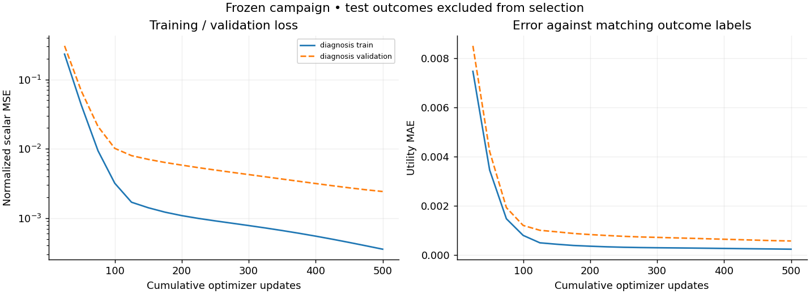
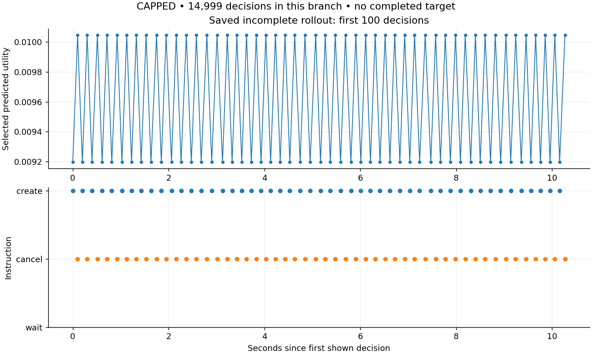
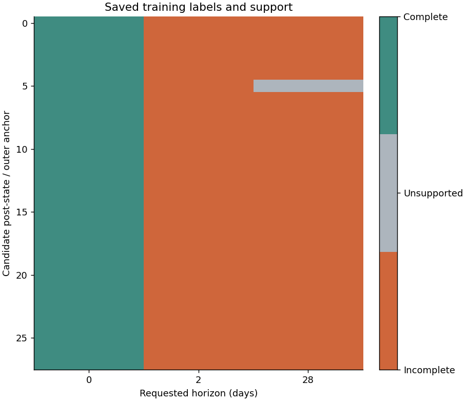
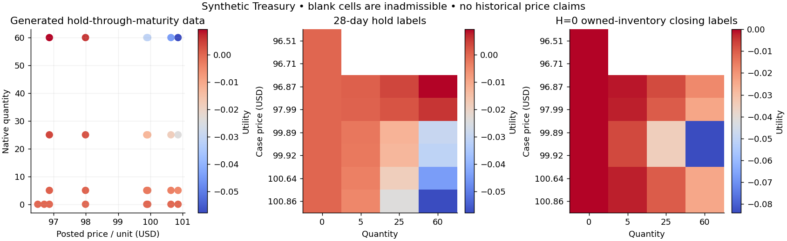
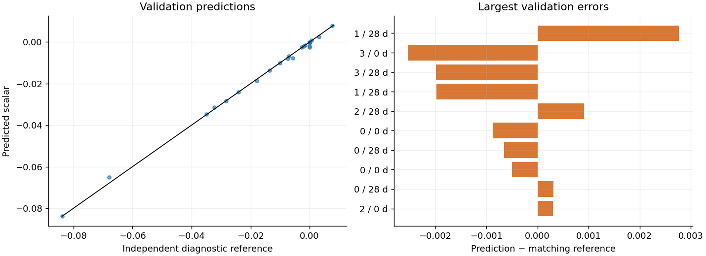

# Treasury max–min implementation and bounded campaign

28 October 2026. Research-only branch `agent/btc-post-decision-value-v1`.

Follow-up: a [smaller four-history-step diagnostic](TREASURY_SMALL_DIAGNOSTIC.md)
completed a separate 500-update fit. Initial choices were all correct, but
scalar-value calibration failed and its fresh test was withheld. It does not
change the original campaign evidence below or resolve repeated-policy churn.

**Implementation delivered; repeated-policy learning is not accepted.** The
one permitted campaign passed the tiny hold/boundary diagnostic, then stopped
at the shared 20,000-decision cap during collection. No rollout refit, recollect
or fresh held-out evaluation occurred. The test generator specifications are
frozen, but its tape/outcomes were not evaluated. No deployment or live trading.

**236 software tests passed:** 153 post-decision tests (including 25 new semantic/integration checks)
and 83 existing funded-ledger/transfer-economics/execution regressions.

## Stage evidence

| Stage | Actual outcome |
| --- | --- |
| 0 — freeze | Config, source/fixture hashes, fresh seeds, split buffers, gates and aggregate caps recorded before fitting. |
| 1 — labels | Independent hold/boundary arithmetic agrees with replay; sequential partial closes, liabilities, native P&L, cancellation and explicit spot repurchase tested. |
| 2 — diagnosis | Passed: correct quantities/actions in 8/8 training and 4/4 validation cases; diagnostic errors below frozen thresholds. |
| 3 — collector | Implemented and semantically tested. Campaign retained complete, incomplete and unsupported matrices; stopped on caps. |
| 4 — references | Independent signed-fill reconstruction and finite causal Treasury oracle implemented/tested. Campaign policy/oracle comparison blocked by collection failure. |
| 5 — bounded cycle | Failed to complete collection. Zero robust refits; fresh test untouched. |
| 6 — publication | Configs, source snapshot, matrices, checkpoints, traces, plots and checksummed restoration bundle retained; immutable download receipt accompanies this report. |

## What changed

- `liquidation.py`: separate closing calculator on a copied native ledger. It
  atomically cancels outstanding/in-flight instructions, releases reservations,
  consumes subsequent opposite-side prints chronologically at print prices,
  respects native lots/participation/fees, pays dated obligations and redemption
  once, and never repairs BTC automatically. Incomplete tails have **no utility
  label**. The strategic deadline and utility ignore closing duration.
- `robust_rollout.py`: cloned post-states and clocks, fixed physical deadlines,
  matched K full paths for each frozen causal controller, independent controller
  exploration seeds, `max_j min_k` reduction, coherent joint worst outcomes,
  independent winner audits, per-horizon support masks and aggregate budgets.
- `treasury_fixtures.py`: one 28-day synthetic bill, funded quantity grid,
  chronological split allocations with two-day closing buffers, independent
  accounting references and a bounded finite-toy oracle.
- `treasury_model.py`: separate 3,409-parameter scalar MLP with two width-48 SiLU
  layers and training-only feature/label normalization. Legacy Transformer
  schemas/checkpoints retain their original behavior. Diagnostic targets are
  explicitly distinct from sampled-max–min targets in checkpoint metadata.
- `treasury_learning.py`: frozen config-driven diagnosis, collection/refit and
  recollection/refit stages, validation selection, one final test pass if gates
  permit, cap handling and inference-only verification. The unexecuted later
  stages are code paths, not completed experiment results.
- `treasury_plots.py` / `treasury_artifacts.py`: saved-data plots, checksummed
  packaging, bounded safe extraction and restoration. `Engine.event_trace` is
  opt-in and labels hidden arrivals/trades separately from received reports.

## Diagnostic result

The old encoding can carry history ages of **38,880 minutes** into its network
for this short Treasury fixture. The prior archived model had 89.7% saturated
final Tanh activations. The new ablation combines bounded relative time,
training-only normalization, a small SiLU MLP and scalar-only regression.
Its success does **not** isolate which of these changes caused the improvement.

| Diagnostic | Training | Validation |
| --- | ---: | ---: |
| Cases / complete labels | 8 / 52 | 4 / 26 |
| Correct hold action/quantity | 8/8 | 4/4 |
| Utility MAE | 0.000231721 | 0.000565977 |
| Maximum utility error | 0.001572084 | 0.002769321 |
| Normalized scalar MSE | 0.000355261 | 0.002414108 |

Profitable cases select 60 units; overpriced, fee-erased and cash-constrained
cases select wait. Funding admission enforces the constrained cases. These
tiny development results are not held-out strategy acceptance or profitability.
Gradients, activation magnitudes, scales and all 500-update curves are included.



## Why repeated collection stopped

The diagnosed model was trained on initial hold-through-maturity and owned
inventory boundary controls. It was not yet calibrated on intermediate-horizon
pending/cancel states. In a two-day rollout, its greedy controller alternated
between creating and cancelling: selected estimates were about 0.00920 for
creation and 0.01005 for cancellation. Each received acknowledgement generated
another legitimate observable event wakeup.

The longest saved branch has **14,999 decisions: 7,500 creates and 7,499 cancels**,
mostly triggered by received order reports. It hit the per-replay event ceiling;
the shared campaign then exhausted its 20,000 decisions. This occurred even for
the zero-exploration controller, so exploration alone does not explain it.
No synthetic dwell time, oracle action override, extended cap or retry was added
to conceal the failure.

| Saved collection | Complete | Incomplete | Unsupported |
| --- | ---: | ---: | ---: |
| Training, first collection | 28 | 55 | 1 |
| Validation, first collection | 13 | 26 | 0 |

Complete retained samples are boundary labels; these do not establish a learned
positive-horizon conservative value. All adverse incomplete replicas remain
visible. The checkpoint is **diagnostic-hold-boundary-v1**, not a fitted rollout
checkpoint. A post-run metadata correction made this distinction explicit
without modifying weights, optimizer or RNG; its before/after hashes are retained.





The next separately bounded learning scope should cover short horizons and
pending/confirmed/cancel post-states before repeated collection. It must preserve
event semantics and the fixed objective, and distinguish improved calibration
from policy-churn suppression. This campaign did not perform that further work.

## Reference scope and assumptions

The independent liquidation arithmetic uses subsequent trades, not model
predictions. The separate signed-fill audit reconstructs sampled-controller
cashflows and recomputes the same joint max–min statistic.

The finite oracle covers two fixed-price purchase opportunities, quantities
0/5/25/60, a 60-unit cap, one Treasury, the same fees and cash restrictions,
known $100 maturity redemption and the declared complete delay paths. It
enumerates causal quantity choices after received fills. Constant entry cost
and an exit bid below entry bound any intermediate purchase/cancel controller
by the enumerated zero/60-unit endpoints. It does not claim an optimum for
arbitrary prices, sells, multiple assets, or long uncertainty trees.

J=2, K=2; the same synthetic tape is used across K, reseeding only future
message/report delays. Already sampled latent queue events are preserved.
Independent winner audit uses a separate seed. No market-return uncertainty,
real liquidity/depth or historical Treasury executions are inferred. Receipts
remain contractual projections. The fixed-deadline policy and two-day closing
buffer are not a rolling-horizon or rate-based policy experiment.





## Resources and reproduction

The campaign ran in ChatGPT's Linux workspace, on an AMD EPYC 9V74 CPU, one
Torch/BLAS thread, Python 3.12.14, Torch 2.14.1+cpu and NumPy 2.3.5. It did not
run on the user's Windows computer or GCP. Recorded campaign work: **88.33 wall
seconds / 88.32 CPU seconds**, 500 optimizer updates, 0.301 seconds of timed optimizer-update work,
20,000 decisions, 43,312 aggregate exchange/report/closing events, 372 distinct
input rows (5,416 compressed bytes), peak RSS approximately 1.16 GiB. Event
counts are cumulative across branches; the per-replay ceiling is 30,000.
The executed snapshot did not separately time the complete fitting phase; total
campaign wall time was itself below the 120-second fitting ceiling. Final source
counts normalization, validation and checkpoint I/O in the fitting timer, including
interrupted fits; that correction is unit-tested without another training run.
Software regression checks, artifact plotting and packaging are reported
separately from campaign work; none is an additional learning campaign.

From the research checkout with its CPU Torch environment:

```bash
OMP_NUM_THREADS=1 MKL_NUM_THREADS=1 OPENBLAS_NUM_THREADS=1 \
  python -m unittest discover -s tests/post_decision_value -v
python -m unittest tests.test_funded_ledger \
  tests.test_paired_transfer_economics tests.test_paired_execution_study -v

# A new bounded reproduction; never reuses an output directory or resets its caps.
OMP_NUM_THREADS=1 MKL_NUM_THREADS=1 OPENBLAS_NUM_THREADS=1 \
  python -m research.post_decision_value.treasury_learning run \
  --config research/post_decision_value/treasury_learning_config.json \
  --output /tmp/treasury-maxmin-new

# Existing artifacts only: no training, new labels, or fresh-test evaluation.
python -m research.post_decision_value.treasury_learning verify \
  --output /path/to/treasury-maxmin-v1
python -m research.post_decision_value.treasury_learning plots \
  --output /path/to/treasury-maxmin-v1
python -m research.post_decision_value.treasury_artifacts restore \
  --archive treasury-maxmin-v1.tar.gz --sha256 HASH_FROM_RECEIPT \
  --output /tmp/treasury-restored
```

The configuration is the collection/training/evaluation contract; there is no
separate CLI that silently reruns a supposedly untouched test set. The exact
executed source snapshot matches SHA256
`80927c969570dd974a5980d0e2bcafb005e2191cf07684ca4f9df895782d3c5f`.
Final source also includes the post-run checkpoint metadata distinction and
artifact helpers. The retained inference examples reproduce exactly.

Files: [machine-readable report](treasury-maxmin-v1-report.json),
[download/checksum receipt](treasury-maxmin-v1-artifacts.json),
[complete bundle](treasury-maxmin-v1.tar.gz). The inference manifest states the
active diagnostic target, failed repeated-policy status, objective, normalization,
scenario/controller identities, closing convention and domain restrictions.
Subsequent UI task: the [local explorer and optional market simulator](STATE_VALUE_EXPLORER.md)
are now implemented. They preserve this failed repeated-policy acceptance and do
not change these learning results. No new campaign ran.

Publication verification: downloaded the immutable archive in the receipt, checked
SHA256/size and every manifest entry, safely extracted it, then ran its standalone
`verify_inference.py`: four predictions and 52 independently recomputed reference
values passed. The artifact commit is `cd7839d46ed0a7004546d7d6a6a36844dc959b73`.
The bundle retains the 235-test publication snapshot; the final fitting-timer
regression brings the delivery checkout to 236 passing tests.
