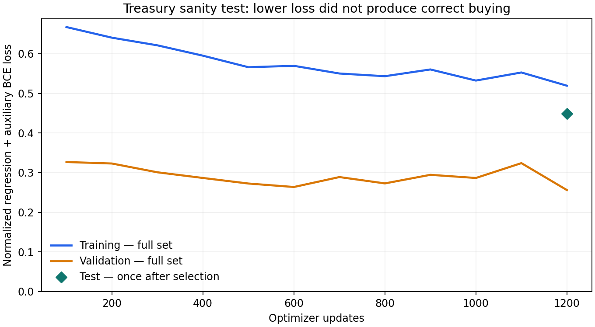

# Treasury learning sanity test and long-history readiness

27 October 2026, UTC. Research branch `agent/btc-post-decision-value-v1`.

**Infrastructure smoke passes; Treasury policy-learning gate fails. Years-long
training is not ready end to end.** No cloud job, provisioning, deployment, data
download or live order was performed. This is a bounded synthetic experiment,
not a historical Treasury backtest or measured annual training run.

## Readiness

The logical futures-union reader, exact event execution, seeded delays,
observable post-decision features, event clock, Torch regression and local/GCS
checkpoint primitives exist. All **211 tests pass**: 128 post-decision and 83
existing ledger/paired-strategy tests. Four new experiment-integrity tests cover
full split tails, labels, known optimal actions and exact checkpoint recovery
across a 364-day Treasury maturity.

A fresh two-minute cached historical hold probe processed all 14 exchange/report
events with identical outcomes: 240 decisions at 500 ms versus 6 event-triggered
decisions. This is inverse-source/counterfactual-linear data; no learned action
search is timed and no annual throughput is established.

Remaining blockers:

1. A streaming **PDV collection runner** must connect the logical reader to the
   event queue, retain source cursors and unlabeled samples, resume the same
   financial trajectory across compute chunks, and label only complete outcomes.
   Existing analytical replay/checkpoint components are not that complete training
   pipeline. The current pilot has short fixed windows and queues its supplied tape.
2. Joint data eligibility: executable or explicitly modeled spot/Treasury prices,
   USD conversion, missing daily futures settlements, financing/collateral evidence
   and executable expiry bridges. Public quotations and contractual receipts do
   not establish realized executions/payments.
3. The proposed research container/Batch tasks, IAM, restart integration, bounded
   cache, busy-period benchmark and aggregate cost/runtime budget are not ready as
   a training service. Existing application infrastructure is not a PDV deployment.
4. The isolated learning gate below must pass before costly carry/multi-year work.

## Frozen experiment

`research.post_decision_value.treasury_sanity` uses the existing schema-3
**88,901-parameter** width-64, two-layer/four-head Transformer value model.
No model, accounting, objective or execution behavior was changed for this run.
Utility weights positive BTC/USD growth equally and penalizes each negative growth
with lambda=10. All five heads describe **one initial instruction followed by hold
to maturity**. Labels come from complete engine replays, not analytical substitution.

Each case offers cash/wait or a limit purchase of **5, 25 or 60 native units** of
one bill paying $100/unit. Initial USD is $8,000/$10,000/$12,000 and BTC is 1.
The posted limit equals the received fixture price, rounded to $0.01 ticks. The
engine executes a later strict-through sell print at the posted price plus fees,
then processes maturity and delayed reports. Latencies use seeded jitter. This
simple deterministic fill opportunity isolates carry learning; it provides no
evidence of real Treasury liquidity, depth or subsecond access.

Four equally represented case types:

- Profitable: price $96–$99.60; fees 0/5/15 bp. Buying 60 units is optimal.
- Overpriced: price $100.10–$102; same fee choices. Cash is optimal.
- Fees erase gains: price $99.85–$99.98; fees 30/50/75 bp. Cash is optimal.
- Cash constrained: only $1 unpledged USD; admission rejects all purchases.
  This is enforced safety, not learned constraint reasoning.

Maturities are **28, 91, 182 and 364 actual calendar days**. Sparse event replay
jumps over quiet time, rather than visiting half-second decisions. Simulated
Treasury payments retain `contractual/projected` provenance after maturity.

| Split | Cases | Admitted post-states | Synthetic starts |
|---|---:|---:|---|
| Training | 128 | 416 | January 1 of 2016/2017/2018 |
| Validation | 48 | 156 | January 1, 2019 |
| Test | 64 | 208 | January 1, 2020 |

Every maturity/report tail fits inside its split. Separate seeded generators vary
prices, fees, cash, maturities and delays; all candidates from one case stay
together. **These dates are fixture coordinates, not historical market data.**
Fixtures and gates were frozen before fitting; test outcomes were collected and
evaluated only after selecting the checkpoint on validation.

Training: 1,200 updates, batch size 32, Adam 0.001, training-only label normalization.
Full training/validation loss was measured every 100 updates; minimum validation
loss selected update 1,200. Test loss was measured once. Acceptance requires at
least 95% optimal choices on profitable cases, all loss/cash cases correct, and
mean utility regret <=0.0001. Lower regression loss alone does not pass the gate.

## Results

| Held-out type | Correct choices | Bill purchases |
|---|---:|---:|
| Profitable | **0/16** | 0 |
| Overpriced | 16/16 | 0 |
| Fee-erased | 16/16 | 0 |
| Cash constrained | 16/16, enforced by admission | 0 |

The model chose cash in all 64 cases: zero BTC/USD growth and utility, matching
cash hold. The fixture oracle (best offered funded action, same hold continuation)
has mean utility **0.0016985900** over all cases. On profitable cases its mean USD
growth is **1.3588720%**, utility **0.6794360%**. These are engineered outcomes over
mixed maturities, not annualized returns. Mean model regret is 0.0016985900.

Full training loss: 0.667341 at update 100 to 0.519395 at 1,200. Validation:
0.326856 to 0.256141. Selected test loss: 0.448433; scalar MAE: 0.00996555.
These are regression/auxiliary classification losses, not investment losses.



The model also misses **all 32 profitable training cases**: the failure exists
within training data. A diagnostic found 89.7% of final hidden Tanh activations
above 0.99 absolute magnitude. Inspect time/economic feature scaling, saturation
and asymmetric label/loss balance next. This diagnostic does not prove one cause.
Do not tune against these now-examined test cases and still call them untouched;
a corrected development experiment needs a fresh frozen test set.

Resources: **18.13 seconds wall / 18.10 CPU seconds**, including **12.75 seconds
fitting**, one Torch/BLAS thread, 5,520 sparse replay events. Caps: 240 seconds total,
120 seconds fitting, 1,200 updates, below project caps. This is not a full-year
market-tape cost estimate. No additional training was launched to force a pass.

## Reproduction and artifacts

From the research checkout with Torch/NumPy:

```bash
OMP_NUM_THREADS=1 MKL_NUM_THREADS=1 python -m unittest discover -s tests/post_decision_value -v
OMP_NUM_THREADS=1 MKL_NUM_THREADS=1 python -m research.post_decision_value.treasury_sanity \
  --output /tmp/treasury-sanity-new
python -m research.post_decision_value.clock_probe \
  --input /path/to/dec_mar_inputs --output /tmp/clock-probe-new.json
```

Output directories are new/immutable. Inspect `report.json`'s `passed` and `gates`:
command completion is not policy acceptance.

- [Report JSON](treasury-sanity-report.json)
- [Artifact receipt](treasury-sanity-artifacts.json)
- [Complete run archive](treasury-sanity-v1.tar.gz)

The archive contains configs, fixtures/admission decisions, all complete-outcome
samples, held-out predictions/fills, minibatch losses/full loss curves,
selected/latest model plus optimizer/RNG, diagnostics, fresh clock probe, test
logs and exact source snapshot. Identity records the base commit and SHA256 of
actual executed Python sources; the snapshot was verified against that hash.
The updated [longer-training plan](WEIGHTED_EVENT_TRAINING_PLAN.md) records the
two-era historical split proposal, still subject to the readiness gates above.
