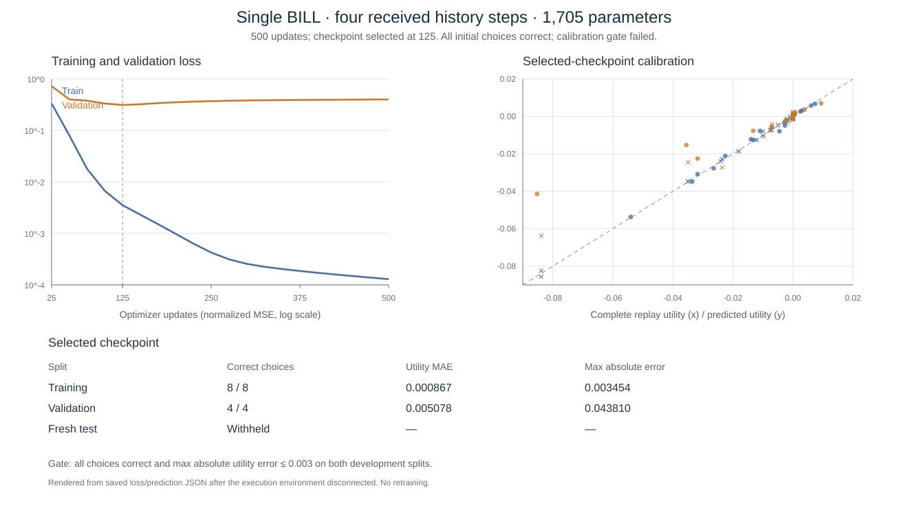

# Small single-BILL diagnostic: four history steps

28 October 2026. Research branch `agent/btc-post-decision-value-v1`.

The requested small diagnostic was trained and analyzed once. It learned the
correct initial action/quantity in **8/8 training and 4/4 validation cases**, but
failed the frozen scalar-value calibration gate. The fresh test was withheld.
This result is a hold/boundary diagnostic, not a repeated-policy or sampled
max–min result. No deployment occurred.

## Experiment

| Setting | Frozen value |
| --- | --- |
| Instruments | One synthetic BILL, face value $100, maturity 28 days |
| Initial portfolio | 1 BTC and $10,000; 10% initial-quantity drawdown floors |
| History | Four actually received trade records, initially spaced one second apart |
| Network | 44 inputs; two width-24 SiLU hidden layers; scalar output; 1,705 parameters |
| Training / validation / reserved test | 8 / 4 / 4 cases, separate generator seeds and nonoverlapping date coordinates |
| Initial actions | Hold cash or buy 5, 25, 60 units at the fixed initial price, subject to admission |
| Objective | BTC/USD positive-growth weights 0.5/0.5; negative-growth multiplier 10; failure penalty 1 |
| Learning budget | 500 full-batch Adam updates, one CPU thread; 240-second campaign ceiling |
| Selection | Lowest validation normalized MSE among checkpoints every 25 updates |
| Acceptance | Every selected quantity optimal, and maximum absolute utility error at most 0.003, on both development splits before test |

The new network has roughly half the parameters of the previous 3,409-parameter
Treasury scalar diagnostic. That older network did **not** consume a history
sequence; it used the latest received price/age within 20 inputs. The legacy
88,901-parameter Transformer is a separate earlier model. This experiment adds
an explicit four-record window rather than claiming to shorten an existing
Treasury sequence model. Its checkpoint uses a distinct schema and loader.

Each of four historical records contributes price, volume, aggressor side, age,
receipt delay and validity. Only received records enter features. The first and
last seed prices equal the declared fixed purchase price; intermediate tick
variation, volume and side are nuisance information unrelated to future payoff.
The encoder selects the latest four records at later states too. The engine
continues processing the full tape, two partial entry fills, delayed reports,
fees, and day-28 redemption. Truncating the model input does not truncate labels.

Dates are synthetic coordinates, not historical market evidence. The four
categories are profitable, overpriced, fee-erased and cash-constrained. Two
training cases per category yield 52 complete labels; one validation case per
category yields 26. Labels include initial actions held through redemption and
already-owned inventory liquidated at the zero-horizon boundary.

## Measured result

Training and replay completed in **12.09 seconds wall time**, with 8.67 seconds
inside fitting, 500 optimizer updates, 258 decisions, and 2,937 counted
exchange/report/closing events. The run used Windows, CPython 3.13.5,
PyTorch 2.7.1+cpu and NumPy 2.3.0. These are the actual installed versions for
this run, distinct from the explorer installer's pinned environment.

The selected checkpoint was update **125**, not the final update 500.

| Checkpoint / split | Correct initial choices | Utility MAE | Maximum absolute error | Calibration gate |
| --- | ---: | ---: | ---: | --- |
| Selected 125 / training | 8/8 | 0.000867 | 0.003454 | Failed |
| Selected 125 / validation | 4/4 | 0.005078 | 0.043810 | Failed |
| Final 500 / training | 8/8 | 0.000147 | 0.000742 | Passed |
| Final 500 / validation | 4/4 | 0.006046 | 0.049597 | Failed |
| Reserved fresh test | Not evaluated | — | — | Development gate blocked |

These errors are in the agreed scalar utility units, not portfolio return
percentages. Validation MSE reached its minimum at update 125; continuing
optimization improved training fit while validation error grew. All initial
choices remained correct, so action ranking and calibrated value prediction
give different verdicts. The trivial cash-constrained case has only a feasible
cash action; the case accuracy denominator includes it.



## What the analysis identifies

The largest error is the validation overpriced BILL at $101.37 with a 5 bp fee,
buying 60 units. Its true utility is **−0.0852411**; the selected model predicts
**−0.0414309**, understating the loss. The training overpriced prices were only
$100.39 and $100.80. This is evidence of poor generalization outside the tiny
training support, even though cash still ranks above the losing purchases.

There is also sensitivity to irrelevant history. A training case and validation
case share a $99.93 price, 60 bp fee, 60-unit purchase and true utility
−0.0317748. Their predictions are −0.0308679 and −0.0225577. Their original 20
economic features differ only by a negligible received-age value; their four
history records differ. The saved post-hoc history-swap analysis isolates this
sensitivity without fitting or selecting another model. It is a diagnostic
probe, not a deployable policy evaluation.

Independent cash arithmetic agrees with **all 78 evaluated labels**: maximum
native-balance discrepancy is $1.82×10⁻¹² and utility discrepancy is
1.82×10⁻¹⁵. Checkpoint restoration reproduces predictions and the exact frozen
model fingerprint. These checks support the simulator/label plumbing; they do
not rescue the failed value-calibration gate.

The inspected training replay fills 30 units twice, holds 60 units, redeems
once on day 28, and ends with no BILL inventory. Its cash balance temporarily
falls because cash is exchanged for BILL inventory; the plot is not a
mark-to-market wealth curve.

The useful next diagnostic would control economic input coverage and test
history-invariant features on development data. This run does not establish
whether history length, network width, or sample size individually caused the
change: they were changed together, with new fixture seeds. No retry, parameter
sweep, repeated-policy collection or fresh-test inspection followed the result.
The earlier cancel/repost churn remains a separate unresolved issue.

## Reproduce and inspect

From the repository root, in an environment with CPU PyTorch and NumPy, set
`OMP_NUM_THREADS`, `MKL_NUM_THREADS`, and `OPENBLAS_NUM_THREADS` to `1`. Use a new
output directory; the runner refuses to overwrite an existing campaign.

```text
python -m research.post_decision_value.treasury_small_diagnostic run --source-commit fd86e274a0d1fb664797be34c2a7acb158aa4575 --output small-bill-rerun
python -m research.post_decision_value.treasury_small_diagnostic verify --output small-bill-rerun
python -m research.post_decision_value.treasury_small_analysis --output small-bill-rerun
python -m research.post_decision_value.treasury_small_plots --output small-bill-rerun
```

The analysis requires the saved checkpoint; plotting requires Matplotlib and
does not train or generate labels. On Windows the temporary directory must be
writable. The older full-campaign runner still uses Linux-only resource metrics;
its import was made portable so the existing semantic tests can run on Windows.

**49 relevant software tests passed:** 18 accounting, 25 robust-rollout and six
new short-history tests. The new checks cover causal truncation, retained purchase
prices and redemption, feature/checkpoint compatibility, frozen limits and
tamper detection against the selected checkpoint fingerprint.

Saved artifacts: [report](treasury-small-v1/report.json),
[configuration](treasury-small-v1/configuration.json),
[loss curve](treasury-small-v1/learning-curve.json),
[per-action predictions](treasury-small-v1/predictions.json),
[analysis details](treasury-small-v1/analysis-details.json), and
[publication status](treasury-small-v1/publication-status.json).

The execution environment disconnected during publication. The locally verified
restoration bundle (750,658 bytes, SHA-256
`655fc1b512c5a21003a54d9cf68f3ee60c8e4f601770c124626324f77bf015bc`)
contains both checkpoints, replay rows, received histories, the exact source files
hashed at training time, and verification evidence. **That bundle, the binary
checkpoints and compressed replay rows could not be uploaded.** Their inventory
and hash receipt document local creation/verification, not remote availability.
The result JSON and implementation are published. The displayed SVG was rebuilt
from those saved numerical results; the original rendered PNGs remain unavailable. Source identity records upstream
baseline `fd86e274a0d1fb664797be34c2a7acb158aa4575` plus those local source hashes;
it does not pretend the new runner already existed in that baseline commit.

The explorer's packaged model is unchanged and still uses its previous
20-feature checkpoint. This new 44-feature model must be loaded with the new
diagnostic loader; the old loader intentionally rejects it.
