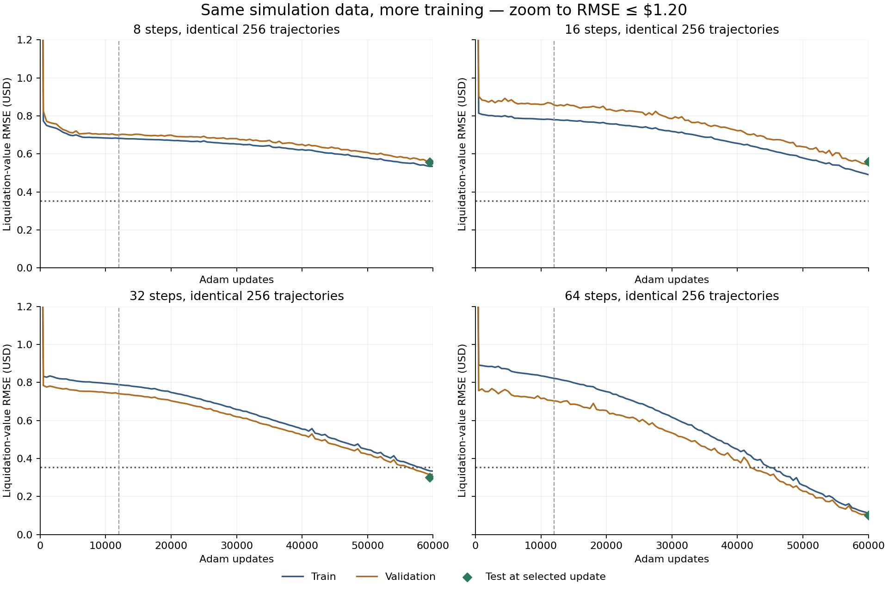
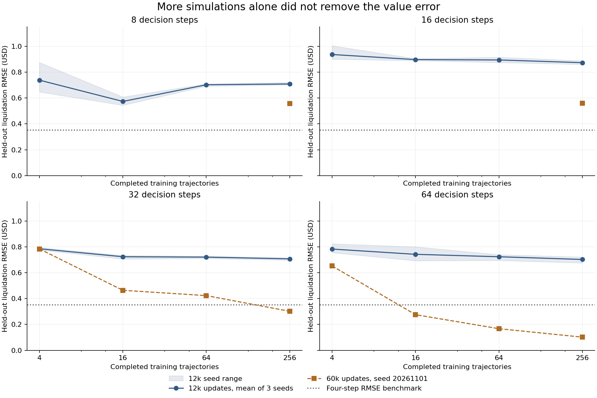

# Longer single-bill timelines: convergence and simulation counts

Measured on 1 November 2026. The original four-step example is preserved beside this report.

**The 32- and 64-step value functions reached the four-step error benchmark after longer optimization.** Adding trajectories without extending optimization did not achieve that benchmark. The smaller 8- and 16-step cases still missed it after 60,000 updates on the tested 256-trajectory datasets.

The same 97-parameter network was used throughout. The benchmark is RMSE ≤ **USD 0.3531**, the previous four-step in-sample error rounded to four decimals. Here the criterion is stronger: three consecutive validation checkpoints (500 updates apart) below the benchmark, plus the selected checkpoint’s test error below it. This is a numerical tolerance, not an assertion of exact or asymptotic convergence.

## How many simulations were enough in the tested runs?

The following are the smallest **tested** successful trajectory budgets at 60,000 updates, seed 20261101. The follow-up budgets and held-out sets were reused adaptively for diagnosis. These counts are not statistical guarantees across seeds or market laws. The 12,000-update experiment tested three seeds.

| Decision steps | Smallest tested successful trajectories | Training transitions | Unique training labels | First sustained validation threshold | Selected update | Test RMSE (USD) |
|---:|---:|---:|---:|---:|---:|---:|
| 8 | Not established; 256 did not pass | 2,048 | 462 | Not reached | 59,500 | 0.5580 |
| 16 | Not established; 256 did not pass | 4,096 | 4,794 | Not reached | 60,000 | 0.5604 |
| 32 | 256 | 8,192 | 36,517 | 57,500 | 59,500 | 0.3016 |
| 64 | 16 | 1,024 | 21,071 | 56,500 | 59,000 | 0.2754 |

For unsuccessful rows, the numbers describe the 256-trajectory follow-up. Smaller budgets for those two timelines were tested at 12,000 updates, not exhaustively at 60,000. Failure at 256 does not prove that every smaller budget or every longer optimization schedule would fail.

## Same data, more optimization

This comparison uses the same 256 trajectories and seed in both columns. The first 12,000 optimizer updates of each extended run reproduce the original run exactly. No new distinct training trajectories were added.

| Steps | Train RMSE at selected 12k checkpoint | Test RMSE at selected 12k checkpoint | Train RMSE at selected 60k checkpoint | Test RMSE at selected 60k checkpoint |
|---:|---:|---:|---:|---:|
| 8 | 0.6822 | 0.7037 | 0.5343 | 0.5580 |
| 16 | 0.7795 | 0.8874 | 0.4909 | 0.5604 |
| 32 | 0.7887 | 0.7082 | 0.3350 | 0.3016 |
| 64 | 0.8218 | 0.7213 | 0.1113 | 0.1018 |



The convergence figure zooms to RMSE ≤ USD 1.20 to expose later training. Larger initial errors remain in the saved curves. The dashed vertical line marks 12,000 updates.

The 8- and 16-step training errors themselves remain above the benchmark. Their remaining error cannot be attributed solely to missing held-out coverage. The cause could involve optimization or the small network’s approximation of short-horizon boundaries; these experiments do not isolate the cause.

## Simulation-budget sweep

48 runs: 8, 16, 32, 64 steps × 4, 16, 64, 256 completed training trajectories × 3 seeds, each with 12,000 Adam updates. Every run starts from a fresh network. Trajectory prefixes are nested within each (timeline, seed), so larger budgets extend the same data.

| Steps | Test RMSE, 4 trajectories | 16 trajectories | 64 trajectories | 256 trajectories |
|---:|---:|---:|---:|---:|
| 8 | 0.7379 | 0.5735 | 0.7022 | 0.7085 |
| 16 | 0.9362 | 0.8970 | 0.8941 | 0.8731 |
| 32 | 0.7849 | 0.7235 | 0.7202 | 0.7068 |
| 64 | 0.7827 | 0.7421 | 0.7233 | 0.7023 |

Values are means over the three seeds. No 12,000-update run met the convergence criterion.



## What is counted as a simulation?

- **Training trajectory:** one complete length-T rollout, with actions chosen uniformly from the legal wait/buy/sell menu.
- **Training transition:** one executed action and its resulting next state. A budget of N trajectories costs N×T transitions.
- **Exact planning action evaluation:** a candidate edge in the shared full-depth search. These are additional to training rollouts.
- **Training label:** one distinct retained (state, remaining horizon) example. All valid horizons, including zero, are included.
- **Optimizer update:** one gradient update using existing labels. It creates no new simulated market trajectory.

Cash enters the terminal value additively, and funding cannot bind in this bounded toy. Therefore all states with the same (time, bill quantity, endpoint) share the same continuation increment, even if their cash balances differ. Dynamic programming evaluates those identical subproblems once. No network values replace terminal labels, and no future depth is truncated.

| Steps | Complete action paths represented from the initial state | Exact planner action evaluations | Liquidation boundary evaluations | Training transitions for 256 trajectories |
|---:|---:|---:|---:|---:|
| 8 | 1,931 | 468 | 45 | 2,048 |
| 16 | 5,992,619 | 1,768 | 85 | 4,096 |
| 32 | 57,734,709,947,051 | 6,864 | 165 | 8,192 |
| 64 | 5,358,925,005,913,472,925,956,745,899 | 27,040 | 325 | 16,384 |

For 64 steps, enumerating roughly 5.36×10²⁷ complete paths would be impractical. The exact shared-state planner performs 27,040 action evaluations covering **all endpoints**, plus 325 closing boundaries. It is built once per timeline and reused across budgets and network seeds. Its measured construction took about 0.011 seconds in this environment; that timing is specific to this very small deterministic state space and excludes data generation and fitting. This affine cash reduction must not be assumed valid with binding funding, hidden orders or path-dependent obligations.

Evaluation costs are separate: each timeline creates 512 deterministic rollouts per held-out split (validation and test), then limits each evaluation set to at most 512 states and approximately 2,048 labels. The same rollout seed is replayed for the two split filters, so those two replay passes are duplicate market paths rather than distinct scenarios. Policy evaluation also simulates candidate actions; its per-run count is recorded in `evaluation_candidate_transitions`. Follow-ups reconstruct the identical training prefixes and reuse the evaluation sets.

## Value convergence versus strategy quality

At 12,000 updates, 47 of 48 fitted networks selected the exact optimal strategy from the initial portfolio through the full timeline, even though their value estimates missed the error threshold. The single exception lost USD 0.125 relative to the exact optimum. All four 256-trajectory 60k follow-ups selected the full-horizon optimum. Across the original 48 runs, the worst average regret over all initial-state horizons was USD 0.074219.

This monotonic tape makes the optimal full-horizon action pattern simple: buy up to four bills as early as possible, then wait. Correct rankings on that path do not certify accurate values for all portfolios or generalization to a new market process.

## Controlled setup and limits

- Initial cash USD 1,000, zero bills; one-unit actions; inventory cap four; face USD 100.
- Price is `P(t)=95+2*t/T`: the same USD 95→97 rise over every strategic timeline. Maturity is `2.5*T`, and the repeated closing tail remains below face value. Thus the experiment varies decision length while preserving the overall price move; it does not hold the per-step drift constant.
- The same two one-unit prints per step, ±USD 0.25 offsets, strict through-limit strategic fills at the limit, subsequent-print liquidation, zero fees/delays and ignored liquidation duration as the four-step example.
- A deterministic hash assigns whole states 70%/15%/15% to train/validation/test. Every horizon of a state stays in that partition; no exact state is shared between train and either holdout. The initial state is explicitly in train. These are state holdouts on the same deterministic market law, not new-market tests.
- Four inputs `(cash-1000)/400, quantity/4, time/T, remaining_horizon/T`; 16 tanh units; 97 parameters; `v=1000+10*network_output`. No architecture enlargement or analytic value skip connection was used.
- Each horizon receives equal sampling weight. Full-batch weighted training is used for at most 256 labels; otherwise each 256-row batch samples horizons uniformly, then rows uniformly within that horizon.
- Adam learning rate 0.003 through update 6,000, then 0.0006. Validation checkpoints every 500 updates; the minimum-validation-RMSE checkpoint is selected before its one test evaluation.
- The original 48-run grid was fixed before running. The 60k extensions and smaller-budget refinements were follow-up diagnoses that reused the holdouts. The successful budgets were checked with one seed, so a robust minimum simulation requirement remains unestablished.

## Reproduction and checks

```bash
cd docs/research/single_bill_full_search
python -m unittest test_longer_timelines -v
OPENBLAS_NUM_THREADS=1 OMP_NUM_THREADS=1 python longer_timelines.py
OPENBLAS_NUM_THREADS=1 OMP_NUM_THREADS=1 python longer_followup.py
OPENBLAS_NUM_THREADS=1 OMP_NUM_THREADS=1 python sample_refinement.py
python report_longer.py
```

The runner bounds the original campaign to 600 seconds and writes results after each completed fit. Each follow-up also has a 600-second bound. Set BLAS to one thread as shown for comparable replay. Python/NumPy are sufficient for fitting; matplotlib is only needed for report figures.

Seven focused tests passed: all 61 original labels, explicit eight-step exhaustive paths, sequential closing prints, split separation/all-horizon coverage, affine cash/count accounting, network initialization, and an independent optimal buy-first cashflow formula for every planner state through 64 steps. Follow-up checks reproduce the first 12,000 updates exactly.

Measured campaign time: original grid 228.7s; 256-trajectory extensions 111.8s; smaller-budget refinements 156.7s. These are wall times on this shared CPU runtime, not hardware-independent throughput claims.

- [All 48 original runs and model weights](longer_results/study.json)
- [Compact original-run table](longer_results/summary.csv)
- [60k-update continuations](longer_results/followup.json)
- [Smaller-budget refinements](longer_results/refinement.json)
- [Machine-readable selected budgets](longer_results/conclusion.json)
