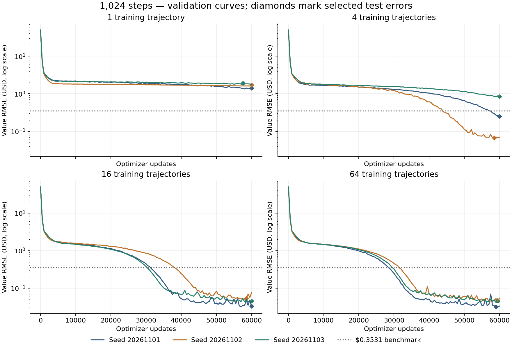
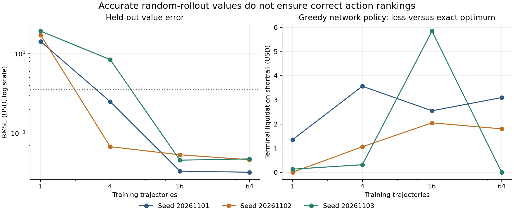

# Single-bill learning at 1,024 timesteps

Measured on 2 November 2026. The original four-step and 8–64-step outputs remain unchanged.

**The value benchmark was reached with 16 training trajectories in all three seeds. The greedy network policy did not reliably converge to the optimal strategy.** Full-depth exact search still returns the optimal strategy; the policy audit below removes that search and chooses actions using only network successor values.

## Why did 64 steps look easier than 8–32?

The previous comparison was not controlled for target geometry, number of state/horizon examples or evaluation weighting. It does not show that longer planning problems are generally easier.

1. **Finer grid, same total price move.** Every case uses P(t)=95+2t/T, so the total rise stays USD 2. Per-step drift falls as T grows; this is not an extension at fixed drift.

2. **Four-bill capacity stays fixed.** At most four purchases fill the portfolio. If h≥4−q, the optimal continuation buys all missing units immediately and then waits. Most long-horizon labels therefore belong to the same simple region of the value function.

3. **Short horizons receive less training weight.** Sampling is uniform over h=0,…,T. The h=0–3 share is 44.4% at T=8, 6.15% at T=64 and 0.390% at T=1024. One longer rollout also supplies more states and many more eligible horizon labels.

4. **The old reported test RMSE had changing weights.** The old evaluation code caps rows per horizon but does not force equal counts when there are few eligible states. Short horizons comprised 95/105 (90.5%) of the eight-step test rows and 128/1818 (7.04%) of the 64-step rows. Thus its across-T RMSE values are not a common-distribution comparison.

Re-evaluating the saved 256-trajectory, 60k-update models gives (USD):

| T | All test RMSE | h=0–3 RMSE | h≥4 RMSE | Short-horizon test rows |
|---:|---:|---:|---:|---:|
| 8 | 0.5580 | 0.5818 | 0.2317 | 95/105 |
| 16 | 0.5604 | 0.6420 | 0.4492 | 512/960 |
| 32 | 0.3016 | 0.4032 | 0.2786 | 256/1627 |
| 64 | 0.1018 | 0.1730 | 0.0943 | 128/1818 |

Improvement remains within both horizon bands, so weighting is only part of the explanation. States also differ across timelines, and the earlier 60k extensions used one seed. These diagnostics do not identify a unique cause of the optimizer’s behavior.

There is an explicit simplification in the targets. With cash c, quantity q, a=2/T, n=4−q, and h≥n, exact value is

$$V(c,q,t,h)=c+q(95.25+a t)+4a h+a\left(9-\frac{n(n-1)}2\right).$$

Only the h<4−q region needs the capacity-incomplete expression. Extrapolating the expression above into that region differs from the exact value by at most 11/T USD in this toy: $1.375 at T=8, $0.171875 at T=64, and about $0.01074 at T=1024. This describes target geometry; the network was not given this expression or an analytic skip connection.

## The 1,024-step experiment

Twelve predetermined fits: 1, 4, 16 or 64 uniformly random legal-action trajectories, each with seeds 20261101–20261103, 60,000 Adam updates, batch size 256, and the original 97-parameter (4 inputs → 16 tanh units → scalar USD value) network. Initial cash is $1,000; inventory cap is four. The price path, strict-through-limit fills, repeated unit prints and future-print liquidation rule are unchanged. Adam uses learning rate 0.003 through update 6,000 and 0.0006 thereafter, as before.

Checkpoints are evaluated every 500 updates. Minimum validation RMSE selects the network. Success requires three consecutive validation checkpoints below $0.3531 and selected test RMSE below it. This is a numerical benchmark, not proof of exact convergence. All errors below are USD.

| Training trajectories | Transitions | Test RMSE range, 3 seeds | Passing seeds | Short h=0–3 RMSE range |
|---:|---:|---:|---:|---:|
| 1 | 1,024 | 1.4238–1.9211 | 0/3 | 2.0845–2.8358 |
| 4 | 4,096 | 0.0673–0.8415 | 2/3 | 0.2291–1.3650 |
| 16 | 16,384 | 0.0332–0.0532 | 3/3 | 0.0817–0.1679 |
| 64 | 65,536 | 0.0321–0.0473 | 3/3 | 0.0962–0.1379 |

Sixteen is the smallest tested budget that passes for all three tested seeds; budgets between 4 and 16 were not tested. With 16 trajectories, sustained validation success occurred at updates 31,500–39,500. All models continued to 60,000; selected checkpoints were at 58,500–60,000. These seeds do not establish a guaranteed minimum or generalization to a different market law.

## Value accuracy versus action quality

The exact full-horizon liquidation is **USD 1008.005859375**. It buys four bills immediately, then waits. With 16 random training trajectories, the greedy network policies fell short of that optimum by $2.0479–$5.8525, despite their low random-state test errors. Their value RMSE along the exact optimal path was $0.847–$1.095. That path audit includes both training and nontraining states and is a distribution diagnostic, not a new holdout.

Random rollouts accumulate costly round trips and visit a different cash/quantity distribution from the buy-and-wait strategy. Also, the advantage of buying now over waiting one step and then acting optimally is only **USD 0.0078125** at the initial state. Low aggregate value RMSE does not guarantee the ordering of such close action values.

As a post-hoc diagnosis, three additional fits added one exact-search-selected full trajectory to the same 16 random trajectories. They kept the network, optimizer and state split unchanged and reused the holdouts. This added-path experiment did not fix greedy decisions (USD):

| Seed | Test RMSE | Greedy terminal shortfall |
|---:|---:|---:|
| 20261101 | 0.0522 | 7.0840 |
| 20261102 | 0.0595 | 8.0059 |
| 20261103 | 0.0545 | 8.0059 |

A single selected trajectory is insufficient evidence of correct counterfactual action rankings. Further strategy work should measure action gaps and train on competing successor states around search-selected paths. That modification was not performed here.

## Counts, execution and limits

- Exact planning evaluates **6,822,400 action edges** across all endpoints, plus **5,125 liquidation boundaries**, once per construction. It shares identical (time, quantity, endpoint) continuations; cash contributes additively. It does not enumerate complete paths or bootstrap from the network. Its array uses 42,025,000 bytes.

- The 16-trajectory datasets contain 11,422–11,532 unique training states and 5,828,797–5,889,975 eligible state/horizon labels. Labels are calculated lazily. Each fit draws 15,360,000 training rows with replacement; not every distinct pair is necessarily visited. Every valid horizon remains eligible.

- Whole states are hashed into a 70%/15%/15% train/validation/test partition. All horizons of a state stay together. There is no exact-state overlap between train and holdout, including the added selected path. These are state holdouts from one deterministic market process.

- Evaluation uses **512 distinct random rollouts (524,288 transitions)** shared across fits. They provide 512 retained states per split, 2,027 validation rows and 2,024 test rows. There are at most two rows per available horizon; the largest horizons can be absent when the split lacks early states. A separate audit covers h=0–3 for all 512 retained test states (2,048 rows).

- The new pools use the same hash split but new bounded row selection for scalability. They are not the same rows as the earlier 8–64-step experiment. Training curves use a fixed horizon-stratified training probe, not full-dataset training RMSE. This does not change gradient sampling.

- Greedy policy audits cover ten endpoints (1,2,3,4,8,16,64,256,512,1024); candidate-transition counts are saved per fit. The augmented experiment replays the same evaluation paths and adds one selected trajectory; its selection evaluates 2,051 successor actions.

- Funding remains feasible: marked wealth changes by q_next·(2/T)−0.25·|action|, implying cash ≥1000−0.25T−4·97=$356 at T=1024 for every legal path, above any required unit purchase. The old coarse bound could not certify T=1024; this tighter proven bound is checked in the new runner.

- Runtime: 101.1s for twelve baseline fits and 27.9s for three augmented fits on this CPU runtime. Timings are environment-specific. Endpoint vectorization preserves exactly the original Bellman recurrence.

## Reproduce

Run from this directory using the adjacent requirements.txt dependencies:

~~~bash
OPENBLAS_NUM_THREADS=1 OMP_NUM_THREADS=1 python -m unittest test_timeline_1024 test_longer_timelines -v
OPENBLAS_NUM_THREADS=1 OMP_NUM_THREADS=1 python timeline_1024.py
OPENBLAS_NUM_THREADS=1 OMP_NUM_THREADS=1 python search_guided_1024.py
OPENBLAS_NUM_THREADS=1 OMP_NUM_THREADS=1 python audit_horizon_effects.py
python report_1024.py
~~~

Twelve focused tests passed, including every 1,024-step planner entry against independent buy-first cashflows, equivalence to the old planner, lazy-versus-dense labels, funding, liquidation tails, state separation, uniform horizon sampling and the original four-step checks. No application or deployment files changed.

- [All twelve runs, curves and weights](results_1024/study.json)
- [Three added-path fits](results_1024/search_guided.json)
- [Horizon-weighting and optimal-path audit](results_1024/horizon_audit.json)
- [Compact run table](results_1024/summary.csv)
- [The earlier longer-timeline report](LONGER_TIMELINES.md)
